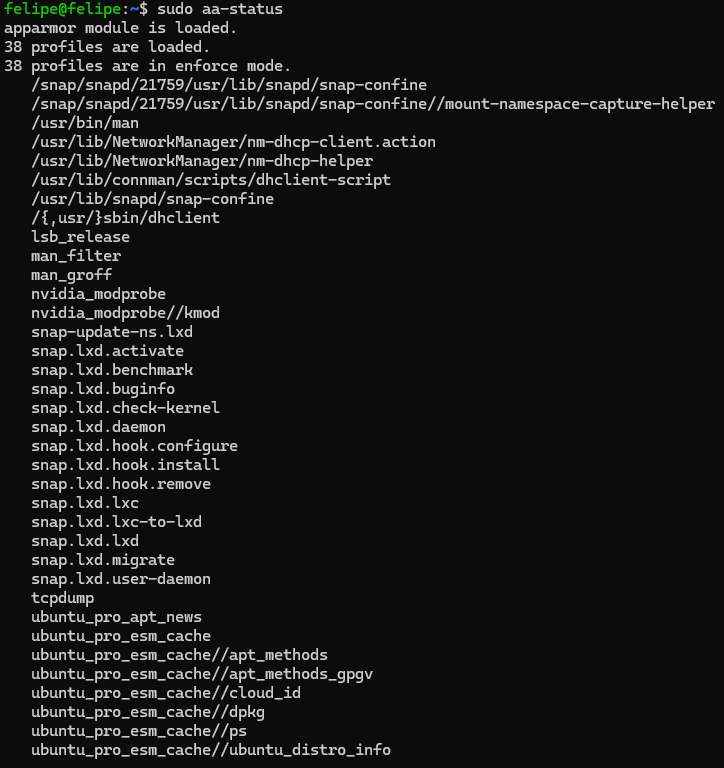
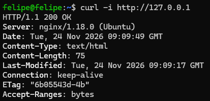
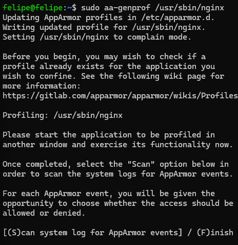
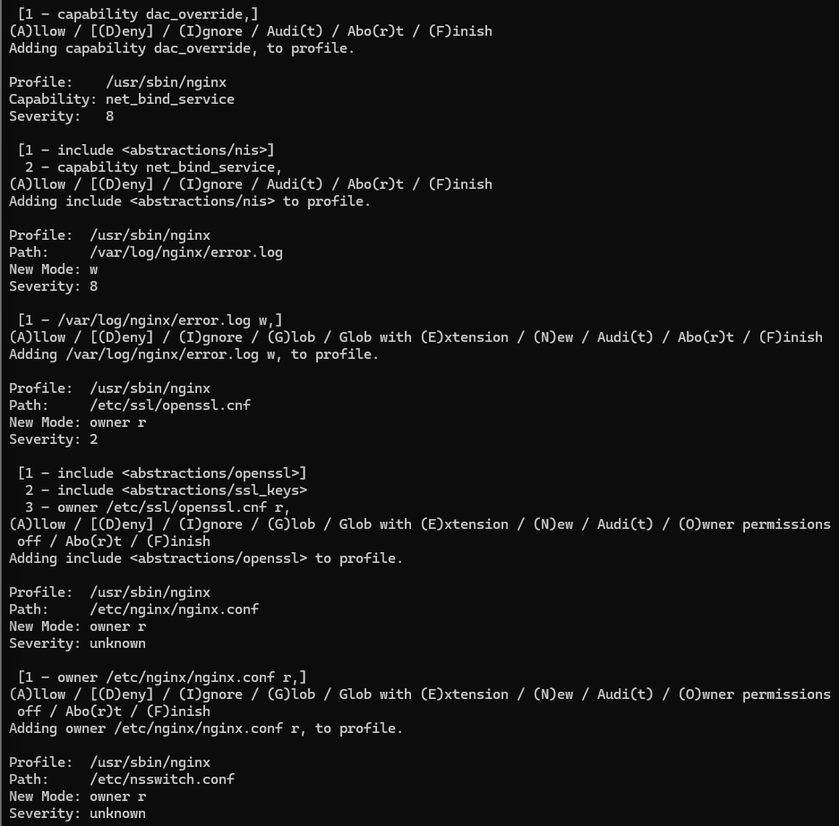
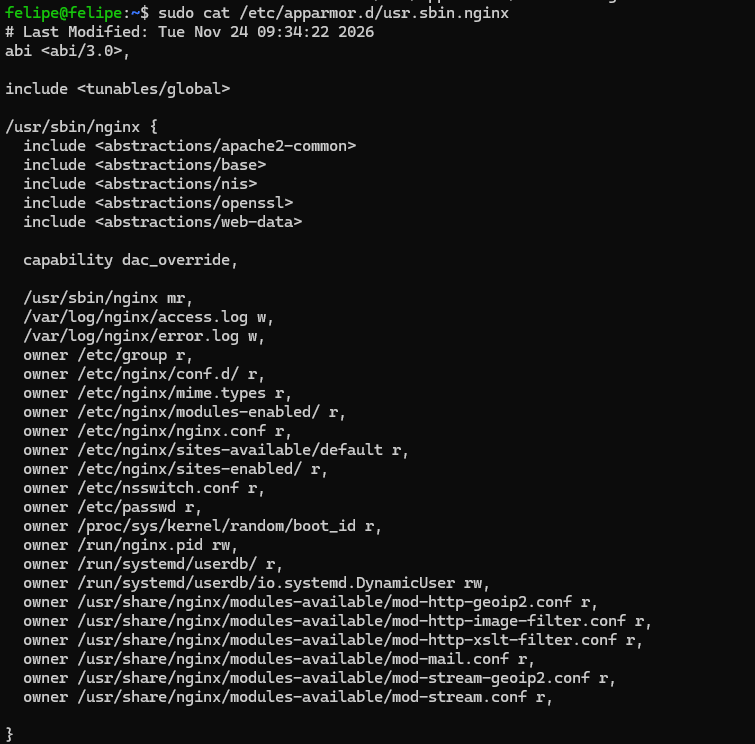
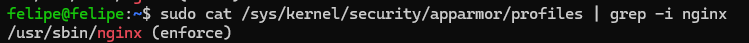
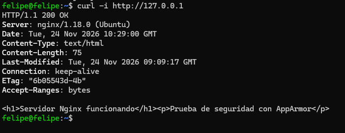

# Práctica: Nginx confinado con AppArmor

**Autor:** Felipe Rodríguez Gómez
**Fecha:** 24/11/2026

## Índice

1. [Objetivo](#1-objetivo)
2. [Entorno utilizado](#2-entorno-utilizado)
3. [Configuración inicial de Nginx](#3-configuración-inicial-de-nginx)
4. [Creación del perfil de AppArmor (modo complain)](#4-creación-del-perfil-de-apparmor-modo-complain)
5. [Registros de eventos detectados](#5-registros-de-eventos-detectados)
6. [Perfil resultante](#6-perfil-resultante)
7. [Activación del modo enforce](#7-activación-del-modo-enforce)
8. [Comprobación final](#8-comprobación-final)
9. [Problemas que tuve](#9-problemas-que-tuve)
10. [Diferencias entre complain y enforce](#10-diferencias-entre-complain-y-enforce)
11. [Reflexión: qué accesos hicieron falta y por qué](#11-reflexión-qué-accesos-hicieron-falta-y-por-qué)

---

## 1. Objetivo

Montar un servidor web Nginx en una máquina Linux y crear un perfil de AppArmor que lo confine. La idea es generar el perfil en modo aprendizaje (*complain*), revisar y ajustar lo que Nginx necesita, pasarlo a modo aplicación (*enforce*) y comprobar que el servicio sigue funcionando.

Para quien no conozca AppArmor: es un sistema de seguridad de Linux que define, programa por programa, a qué archivos y a qué funciones del sistema puede acceder. Por ejemplo, un servidor web normalmente solo necesita leer su configuración y escribir sus logs. Si alguien consiguiera colarse a través de Nginx, AppArmor le impediría tocar cualquier otra cosa del sistema, como `/etc/shadow`.

## 2. Entorno utilizado

| Elemento | Valor |
|---|---|
| Sistema operativo | Ubuntu 22.04.5 LTS (jammy) |
| Servidor web | Nginx 1.18.0 (Ubuntu) |
| Seguridad | AppArmor (con `apparmor-utils`) |
| Otras herramientas | `auditd`, `curl` |
| Nombre del equipo / usuario | `felipe` / `felipe` |

## 3. Configuración inicial de Nginx

Primero actualicé el sistema e instalé Nginx junto con las herramientas necesarias:

```bash
sudo apt update
sudo apt upgrade -y
sudo apt install nginx apparmor apparmor-utils auditd curl -y
sudo systemctl enable --now nginx
sudo systemctl enable --now auditd
```

Qué hace cada paquete:

- `nginx`: el servidor web.
- `apparmor`: el sistema de confinamiento.
- `apparmor-utils`: trae las herramientas `aa-genprof`, `aa-logprof`, `aa-complain`, `aa-enforce`...
- `auditd`: guarda los eventos de auditoría.
- `curl`: para hacer peticiones HTTP de prueba desde la terminal.

Después comprobé el estado de AppArmor antes de tocar nada. En la captura se ve que hay 38 perfiles cargados, todos en enforce, y que **Nginx todavía no tiene perfil**:

```bash
sudo aa-status
```



Y para tener algo que servir, creé una página de prueba, comprobé que la configuración era correcta y que Nginx respondía:

```bash
echo '<h1>Servidor Nginx funcionando</h1><p>Prueba de seguridad con AppArmor</p>' | sudo tee /var/www/html/index.html
sudo nginx -t
curl -i http://127.0.0.1
```

La respuesta fue `HTTP/1.1 200 OK` con el contenido de mi página. Esto demuestra que Nginx funcionaba bien **antes** de aplicarle ninguna restricción:



## 4. Creación del perfil de AppArmor (modo complain)

Paré Nginx y lancé el generador de perfiles sobre el binario:

```bash
sudo systemctl stop nginx
sudo aa-genprof /usr/sbin/nginx
```

Lo que hace `aa-genprof` es crear el perfil y ponerlo directamente en modo *complain*, como se ve en el propio mensaje (`Setting /usr/sbin/nginx to complain mode`). Después se queda esperando a que uses el programa desde otra terminal para ir viendo qué accesos hace.



Desde una segunda terminal arranqué Nginx y lo usé un poco para que se generaran eventos:

```bash
sudo systemctl start nginx
sudo nginx -t
curl -i http://127.0.0.1
sudo systemctl reload nginx
```

Cuando terminé las pruebas volví a la primera terminal y pulsé `S` (*Scan*) para que leyera los logs del sistema y me fuera preguntando por cada acceso detectado.

## 5. Registros de eventos detectados

Con el escaneo, AppArmor me fue enseñando uno a uno los accesos que Nginx había hecho y que el perfil todavía no contemplaba. Para cada uno hay que elegir entre permitir (*Allow*), denegar (*Deny*) o ignorar (*Ignore*). Estos fueron los que salieron:

| Evento detectado | Qué significa |
|---|---|
| `capability dac_override` | Permiso para saltarse las comprobaciones normales de permisos de archivos |
| `capability net_bind_service` | Permiso para abrir puertos por debajo del 1024 (el 80 entra aquí) |
| `/var/log/nginx/error.log` (`w`) | Escribir en el log de errores |
| `/etc/ssl/openssl.cnf` (`owner r`) | Leer la configuración de OpenSSL |
| `/etc/nginx/nginx.conf` (`owner r`) | Leer la configuración principal de Nginx |
| `/etc/nsswitch.conf` (`owner r`) | Leer la configuración de resolución de nombres y usuarios |

Fui permitiendo los accesos que tenían sentido para un servidor web y revisando cada uno antes de aceptarlo, en lugar de darle a Allow a todo sin mirar.



## 6. Perfil resultante

El perfil queda guardado en `/etc/apparmor.d/usr.sbin.nginx`. Lo consulté con:

```bash
sudo cat /etc/apparmor.d/usr.sbin.nginx
```

Se ve que el perfil incluye unas cuantas abstracciones (`base`, `nis`, `openssl`, `web-data`...), que son plantillas de reglas ya preparadas por AppArmor, y después reglas concretas: lectura de la configuración en `/etc/nginx/`, escritura de los logs en `/var/log/nginx/`, lectura/escritura del PID en `/run/nginx.pid`, y lectura de los módulos de `/usr/share/nginx/modules-available/`.



## 7. Activación del modo enforce

Para dejar el perfil aplicado ejecuté:

```bash
sudo aa-enforce /usr/sbin/nginx
```

Y comprobé que el kernel lo tiene cargado en modo enforce:

```bash
sudo cat /sys/kernel/security/apparmor/profiles | grep -i nginx
```

Resultado: `/usr/sbin/nginx (enforce)`



## 8. Comprobación final

Con el perfil ya en enforce, volví a hacer una petición a Nginx:

```bash
curl -i http://127.0.0.1
```

Responde `HTTP/1.1 200 OK` y devuelve la página de prueba, así que el servidor sigue funcionando con el confinamiento activo:



## 9. Problemas que tuve

Al principio Nginx no arrancaba bien. Primero me daba `Permission denied` al abrir `/etc/nginx/nginx.conf` y `/var/log/nginx/error.log`. Más tarde consiguió arrancar y el servicio aparecía como `active (running)`, pero `curl` se quedaba colgado sin respuesta.

Miré el log de errores de Nginx y salía esto:

```text
[emerg] setgid(33) failed (1: Operation not permitted)
[alert] worker process exited with fatal code 2 and cannot be respawned
```

Lo que pasaba es que el proceso principal de Nginx (que corre como root) sí abría el puerto 80, pero no era capaz de crear los procesos *worker*, que son los que atienden las peticiones y corren como el usuario `www-data` (el grupo 33). Por eso se conectaba pero nadie contestaba.

Con `aa-status` y `cat /proc/<PID>/attr/current` vi que el perfil estaba en enforce y que solo tenía permitida la capacidad `dac_override`, así que faltaban permisos para que Nginx pudiera cambiar de usuario y de grupo. Después de corregirlo, Nginx arrancó bien con sus workers y respondió con el 200 OK de la captura anterior.

Me sirvió para entender que un perfil mal ajustado en enforce no da un error muy claro: el servicio parece estar arrancado y aun así no funciona. Y que conviene mirar siempre el `error.log` de Nginx y los logs del kernel.

## 10. Diferencias entre complain y enforce

| | Complain (aprendizaje) | Enforce (aplicación) |
|---|---|---|
| Qué hace con un acceso no permitido | Lo deja pasar y lo apunta en el log | Lo bloquea y lo apunta en el log |
| Para qué se usa | Para descubrir qué necesita un programa | Para proteger el sistema una vez el perfil está ajustado |
| Riesgo | No protege nada todavía | Si el perfil está incompleto, el programa puede fallar |

Un ejemplo sencillo: imagina un portero en una discoteca. En modo complain el portero deja entrar a todo el mundo, pero va apuntando en una libreta quién no estaba en la lista. Con esa libreta se completa la lista. En modo enforce el portero ya no deja entrar a quien no esté en la lista.

## 11. Reflexión: qué accesos hicieron falta y por qué

Los accesos que tuve que permitir se pueden agrupar así:

- **Leer su configuración** (`/etc/nginx/...`, `nginx.conf`, `mime.types`, `sites-enabled`...): sin esto Nginx no sabe ni cómo arrancar.
- **Escribir sus logs** (`/var/log/nginx/access.log` y `error.log`): es la forma de registrar lo que pasa. Solo hace falta escritura, no lectura.
- **Gestionar su PID** (`/run/nginx.pid`): para que el sistema pueda parar o recargar el servicio.
- **Leer ficheros de usuarios y nombres** (`/etc/passwd`, `/etc/group`, `/etc/nsswitch.conf`): necesita saber quién es `www-data` para lanzar los workers con ese usuario.
- **Capacidades** (`dac_override`, `net_bind_service`, y el cambio de usuario/grupo que me dio el problema del apartado 9): Nginx arranca como root para abrir el puerto 80 y luego baja privilegios.

Lo que me llevo de la práctica es que AppArmor permite dejar a un servicio con lo justo para funcionar. Aun así, no sirve de nada aceptar todo lo que sale en `aa-logprof` sin pensar: hay que mirar qué pide cada regla y decidir si tiene sentido para ese programa.
